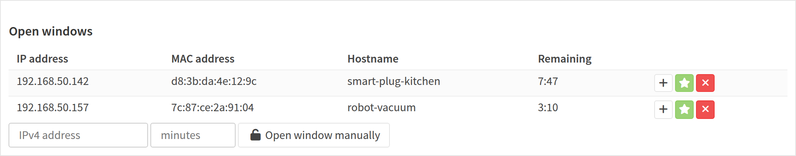
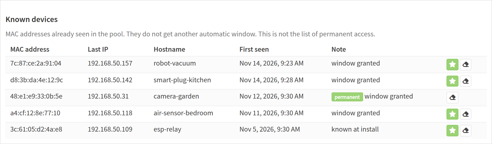
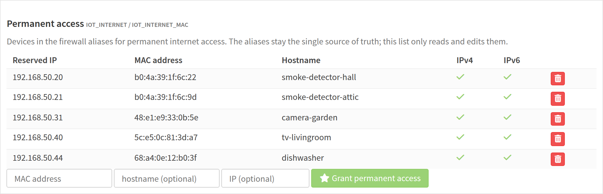
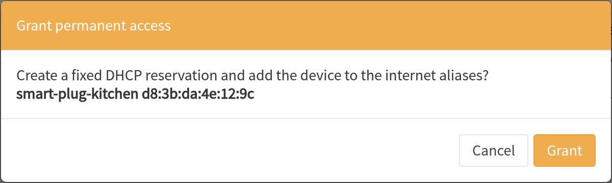
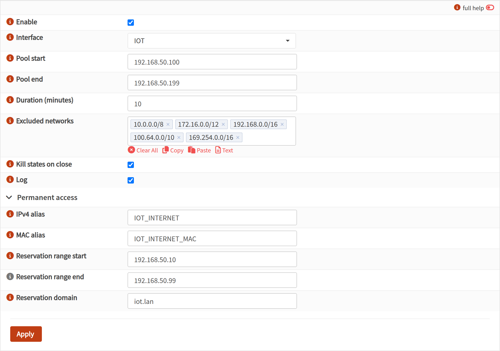

# os-device-onboarding

An OPNsense plugin for onboarding devices in a restricted network, typically an
IoT VLAN without internet access.

- **Setup window:** a device that appears for the **first time** in the dynamic
  DHCP pool of an interface gets internet access for a few minutes (default 10),
  so it can finish its setup with the vendor app or cloud. Afterwards your regular
  firewall policy applies again.
- **Permanent access:** with one click, a device gets a fixed DHCP reservation and
  is added to the firewall aliases that your own rules use for permanent internet
  access. The plugin keeps no list of its own; the aliases remain the single
  source of truth and keep working without the plugin.

It is meant for the usual IoT workflow: plug in a new smart plug, camera or
appliance, let it register for a few minutes, then decide whether it needs
internet permanently, and keep it isolated otherwise.



## Requirements

- OPNsense 25.x / 26.x (developed and tested on 26.7)
- **Dnsmasq** as DHCP server on the interface (the plugin reads
  `/var/db/dnsmasq.leases` and manages Dnsmasq host reservations)
- For permanent access management: an existing *Host(s)* alias and an existing
  *MAC address* alias, each referenced by a pass rule of yours (see below)

## How it works

```
new MAC in DHCP pool ──► watcher ──► pf anchor "deviceonboarding"
                                       table <onboarding>           (open windows)
                                       table <onboarding_internal>  (blocked destinations)
                                       pass in log quick on <if> inet
                                            from <onboarding> to ! <onboarding_internal>
```

- The service `deviceonboarding` (supervised by `daemon(8)`) reads the Dnsmasq
  leases every 15 seconds.
- A MAC address that has never been seen inside the configured pool opens a
  window: its IPv4 address is added to `<onboarding>` and removed again when the
  time is up. Open connections can be dropped at that moment (`pfctl -k`).
- Every MAC address gets **one** window. "Forget" in the GUI allows another one
  as soon as the device requests a new lease.
- **First start:** all devices already present in the pool are only recorded as
  known (baseline). Installing or enabling the plugin opens nothing.
- Destinations in *Excluded networks* (default: RFC 1918, CGNAT, link-local)
  stay blocked during the window, so new devices reach the internet but not
  your other networks.
- The plugin registers the anchor in the ruleset only while it is enabled.
- Addresses outside the pool (your reservations) never get a window.

### IPv6 (optional, since 1.1.0)

IPv6 addresses are formed by the devices themselves (SLAAC, privacy
addresses), so they are not in the DHCP lease file. With *Allow IPv6* enabled,
the watcher looks up the global IPv6 addresses of every device with an open
window in the NDP table (`ndp -an`) every 15 seconds and adds them to the
table `<onboarding6>`; new privacy addresses are picked up while the window is
open. All of them are removed when the window closes.

```
pass in log quick on <if> [route-to (<gw-if> <gw-addr>)] inet6
     from <onboarding6> to ! <onboarding6_internal>
```

- The window is still triggered by the DHCPv4 lease (the MAC address is the key).
  IPv6-only devices without a DHCPv4 lease do not get a window.
- *Excluded IPv6 networks* defaults to ULA, link-local and multicast. Add your
  own global prefixes so new devices cannot reach your other networks.
- *IPv6 gateway* (optional) adds `route-to`. Use it when the prefix of the
  interface is not routed via the default IPv6 gateway, for example with a
  tunnel broker. Without it, the regular routing applies.
- A new privacy address can take up to 15 seconds until it is allowed.



## Permanent access

Create two aliases and the matching rules yourself, for example on the IoT
interface:

| Alias | Type | Rule |
|---|---|---|
| `IOT_INTERNET` | Host(s) | pass, IPv4, source `IOT_INTERNET`, destination: not your internal networks |
| `IOT_INTERNET_MAC` | MAC address | pass, IPv6, source `IOT_INTERNET_MAC`, destination: not your internal networks |

Select both aliases and a reservation range (outside the dynamic pool) in the
plugin settings. Then:

- **Grant permanent access** (star button on an open window or a known device,
  or by MAC address): the plugin creates a Dnsmasq reservation with the next free
  address of the range (or reuses / moves an existing one), adds the IP to the
  host alias and the MAC to the MAC alias, applies Dnsmasq and the aliases and
  closes the setup window. The device gets its new address with its next lease.
- **Remove permanent access:** removes the device from both aliases and drops
  its connections. The reservation is kept.





Using a MAC alias for IPv6 is useful because devices form their IPv6 addresses
themselves (SLAAC). For IPv4 a host alias with the fixed reservation is used: a
MAC alias only knows a device after it appears in the ARP table, which can delay
the first packets of devices that are asleep most of the time.

## Installation

The plugin is not part of the official OPNsense repository. It is available
from its own signed package repository: https://alexsxb.github.io/OPNsense-Device-Onboarding/

### From the package repository (recommended)

Once, as root on the OPNsense console or via SSH:

```sh
mkdir -p /usr/local/etc/pkg/keys
fetch -o /usr/local/etc/pkg/keys/device-onboarding.pub \
  https://alexsxb.github.io/OPNsense-Device-Onboarding/device-onboarding.pub
fetch -o /usr/local/etc/pkg/repos/device-onboarding.conf \
  https://alexsxb.github.io/OPNsense-Device-Onboarding/device-onboarding.conf
pkg update -r device-onboarding
```

Then install **os-device-onboarding** in **System → Firmware → Plugins** (or
`pkg install os-device-onboarding`). Updates show up in **System → Firmware →
Updates**. After a reinstallation of OPNsense, add the repository again; the
settings are part of `config.xml` and come back with a configuration restore.

The repository catalogue is signed; `pkg` verifies it with
`device-onboarding.pub`. The package contains no compiled code and installs on
any OPNsense version (`abi FreeBSD:*:*`).

### From source

1. Once, on the OPNsense host, fetch the plugins source tree:
   ```sh
   sudo opnsense-code plugins
   ```
2. From a checkout of this repository:
   ```sh
   scripts/deploy.sh user@opnsense-host
   ```
   The script copies the sources to `/usr/plugins/net/device-onboarding`, runs
   `make package` and installs the package with `pkg add`.

### After installing

Open **Services → Device Onboarding**, select the interface and the DHCP pool,
enable the plugin and click *Apply*.

**Uninstall:** disable the plugin and apply, then `pkg delete os-device-onboarding`.
To remove the repository as well, delete
`/usr/local/etc/pkg/repos/device-onboarding.conf` and
`/usr/local/etc/pkg/keys/device-onboarding.pub`.

### Releases

A tag `v*` triggers `.github/workflows/repo.yml`: the package is built in a
FreeBSD VM with the OPNsense plugins framework (`scripts/build-repo.sh`), the
repository is signed with the key from the secret `PKG_REPO_KEY_B64`
(base64 of the PEM private key) and published with GitHub Pages.

## Settings



| Setting | Meaning |
|---|---|
| Enable | Start the watcher and register the firewall anchor |
| Interface | Interface the new devices are connected to |
| Pool start / end | Dynamic DHCP range. Only leases inside get a window |
| Duration | Window length in minutes (1–1440) |
| Excluded networks | Destinations that stay blocked during the window |
| Allow IPv6 | Also allow IPv6 during the window (addresses from the NDP table) |
| Excluded IPv6 networks | IPv6 destinations that stay blocked during the window |
| IPv6 gateway | Optional gateway for the window traffic (`route-to`) |
| Kill states on close | Drop open connections when a window closes |
| Log | Log traffic passed by the setup rule |
| IPv4 alias / MAC alias | Existing aliases for permanent access (empty = feature off) |
| Reservation range | Range for new fixed reservations, outside the pool |
| Reservation domain | Optional domain for new reservations |

## API

| Method | Path | |
|---|---|---|
| GET | `/api/deviceonboarding/settings/get` | settings |
| POST | `/api/deviceonboarding/settings/set` | save settings |
| POST | `/api/deviceonboarding/service/reconfigure` | apply (templates, service, firewall) |
| GET | `/api/deviceonboarding/service/list` | open windows and known devices |
| POST | `/api/deviceonboarding/service/open` | `ip`, `minutes` – open or extend a window |
| POST | `/api/deviceonboarding/service/close/<ip>` | close a window |
| POST | `/api/deviceonboarding/service/forget/<mac>` | forget a device |
| GET | `/api/deviceonboarding/permanent/list` | devices with permanent access |
| POST | `/api/deviceonboarding/permanent/add` | `mac`, optional `ip`, `host` |
| POST | `/api/deviceonboarding/permanent/remove` | `mac` |

## Troubleshooting

```sh
sudo pfctl -a deviceonboarding -s rules                  # rule loaded?
sudo pfctl -a deviceonboarding -t onboarding -T show     # open windows (IPv4)
sudo pfctl -a deviceonboarding -t onboarding6 -T show    # open windows (IPv6)
sudo /usr/local/opnsense/scripts/deviceonboarding/ctl.py list
grep deviceonboarding /var/log/system/latest.log
```

Runtime state (known devices, open windows) is kept in
`/var/db/deviceonboarding/state.json`.

## Repository layout

| Path | Purpose |
|---|---|
| `src/opnsense/mvc/app/models/OPNsense/DeviceOnboarding/` | model (`OPNsense/deviceonboarding` in `config.xml`), ACL, menu |
| `src/opnsense/mvc/app/controllers/OPNsense/DeviceOnboarding/` | GUI and API controllers |
| `src/opnsense/mvc/app/views/OPNsense/DeviceOnboarding/index.volt` | GUI page |
| `src/opnsense/scripts/deviceonboarding/` | `watch.py` (service), `ctl.py` (configd/GUI), `common.py` |
| `src/opnsense/service/conf/actions.d/actions_deviceonboarding.conf` | configd actions |
| `src/opnsense/service/templates/OPNsense/DeviceOnboarding/` | rc.conf.d and service configuration |
| `src/etc/rc.d/deviceonboarding` | rc script |
| `src/etc/inc/plugins.inc.d/deviceonboarding.inc` | service registration, firewall anchor |
| `scripts/build-repo.sh`, `repo/`, `.github/workflows/repo.yml` | package repository build and GitHub Pages site |
| `tests/test_common.py` | logic tests without OPNsense (`python3 tests/test_common.py`) |

Screenshots show demo data.

## License

BSD 2-Clause, see [LICENSE](LICENSE).
